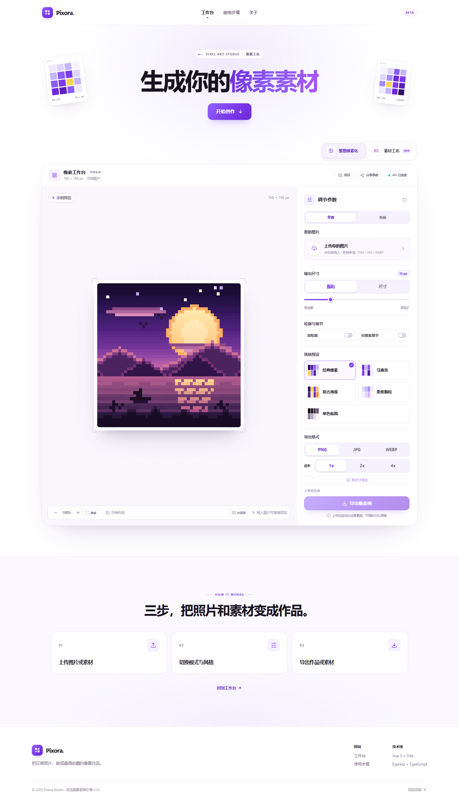
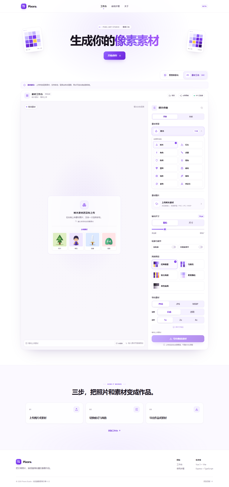
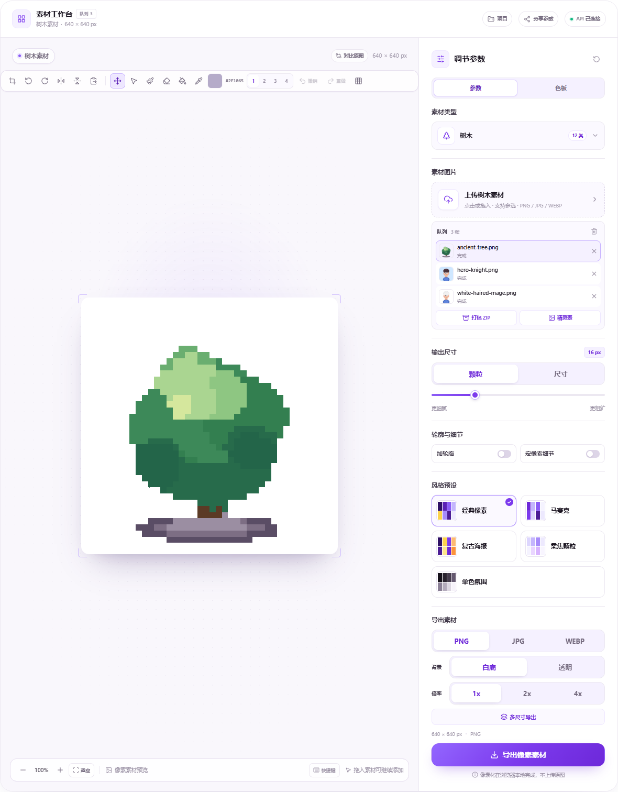
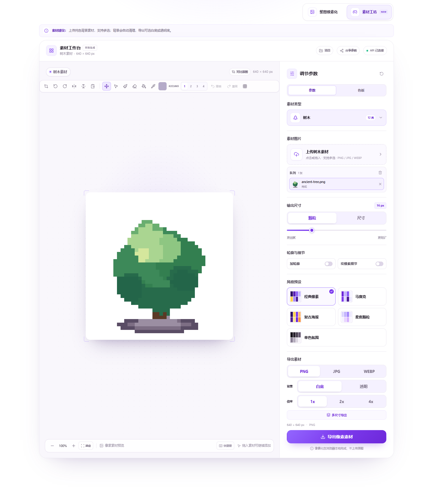

# Pixora · 像素工坊


把照片或游戏素材转换成像素艺术的 local-first 项目。批量导入、裁剪旋转、像素化、手绘修正、调色板、批量打包、项目持久化和离线访问都在浏览器里完成，不需要登录，也不会上传原始图片。

> A local-first pixel art studio for photos and game assets. No sign-up, no image uploads.

- 前端：Vue 3 + TypeScript + Vite
- 后端：Node.js + Express 5 + TypeScript（可选骨架）
- 架构：npm workspaces 单仓 + MVC 分层
- 视觉：白色主调、紫罗兰副调、响应式布局
- 像素画：边缘感知降采样 + Lab 色彩聚类 + 区域平均填色 + 可选轮廓
- 文档：[架构说明](docs/ARCHITECTURE.md) · [贡献指南](CONTRIBUTING.md) · [安全策略](SECURITY.md) · [更新日志](CHANGELOG.md)









> **当前状态**
>
> 可用：整图 / 素材模式、12 类素材、批量队列、ZIP 与精灵表、裁剪旋转翻转、25%–1600% 缩放与空格平移、对比滑块、手绘修正、单像素选择与改色、恢复生成色的橡皮擦、吸管取色和色板同步、参数/色板分页、破坏性操作保护、撤销重做、多尺寸导出、IndexedDB 项目与自动恢复、参数分享链接、PWA 离线。
>
> 占位：服务端文件上传、账号和云端同步。`POST /api/pixelate` 仍返回 `501 Not Implemented`。图片像素化和本地项目存储都不经过服务器。
>
> 当前功能集为 **v1.0.0**：发布前只做稳定性、文档、截图和维护，不新增业务功能。

---

## 1. 快速开始

环境要求：Node.js >= 20.19（CI 使用 Node 22）。

```bash
npm ci
npm run dev
```

启动后访问：

- 前端：<http://localhost:5173>
- API：<http://localhost:3001>
- 健康检查：<http://localhost:3001/api/health>

开发时浏览器请求 `http://localhost:5173/api/*`，Vite 自动代理到 3001 端口。

### 常用命令

| 命令 | 作用 |
| --- | --- |
| `npm run dev` | 同时启动 Vue 与 Express 开发服务器 |
| `npm run dev:web` | 只启动前端 |
| `npm run dev:api` | 只启动后端 |
| `npm run typecheck` | 前后端 TypeScript 类型检查 |
| `npm run build` | 构建前端静态文件与后端 `dist` |
| `npm run preview:web` | 本地预览生产版前端 |
| `npm start` | 运行已构建的后端（需要先 build） |

---

## 2. 现在能做什么

### 2.1 创作模式与素材分类

- **整图像素化**：处理照片、插画和普通图片。
- **素材工坊**：处理单个游戏素材，并通过一个展开按钮选择 12 类：树木、石头、角色、武器、防具、怪物（含巨龙）、道具、建筑、地形、装饰、食物、自定义。
- 素材分类影响角色五官保护、武器固定轮廓、分类标注和导出文件名。

### 2.2 输入与批量队列

- 支持 PNG / JPG / WEBP，单文件最大 10 MB，一次最多 24 张。
- 点击选择、拖入或直接按 `Ctrl/Cmd + V` 粘贴剪贴板图片。
- 批量队列显示缩略图、文件名和每张素材的状态：等待、生成中、完成、失败。
- 每张失败素材可以单独重试；也可以单独移除或清空队列。
- 队列统一使用当前参数；单张素材仍可独立裁剪、旋转、翻转和手绘修正。
- 小于 512 px 的源图会先放大分析图，让降采样、背景识别和边缘检测有更多像素参与。

### 2.3 基础图片编辑

- 裁剪：拖动选框和四角控制点，显示实际裁剪像素尺寸。
- 顺时针 / 逆时针旋转 90°。
- 水平 / 垂直翻转。
- 粘贴剪贴板图片。
- 修改后可恢复最初上传的原图。
- 画布支持 25%–1600% 缩放、`适应` 窗口、`Ctrl/Cmd + 滚轮` 缩放和拖动画布平移。
- 按住 `空格` 拖动可在任意绘制工具下临时平移画布，不必先切回移动工具。
- 原图与像素画对比滑块。

图片调整直接修改“送给像素化引擎的源图”，不会破坏已经生成的低分辨率网格，直到重新生成。

### 2.4 像素画生成

- 5 种风格：经典像素、马赛克、复古海报、柔焦颗粒、单色氛围。
- 最大颜色数：8 / 16 / 32 / 64，并受预设色数上限约束。
- 默认无轮廓，可选标准深色描边或 Selout 暗部描边。
- 宏像素细节：平坦区域保持大块，边缘区域拆成 2×2 微像素。
- 可选 4×4 Bayer 有序抖动。
- 两种尺寸方式：
  - 像素颗粒 1–64 px；
  - 目标分辨率 32 / 64 / 128 / 256 / 512 px 长边。
- 角色分类自动启用五官保护，并保证最小宏观网格。
- 武器分类在固定的 640 px 分析图上提取并缓存轮廓；修改颗粒不会重新改变武器外形。高光面积大时优先保留主体轮廓。
- 全部高开销计算在 Web Worker 中执行；切换参数会取消旧任务。

### 2.5 手绘修正与调色板

- 移动、选择像素、画笔、橡皮擦、油漆桶、吸管取色。
- 箭头选择工具：点击任意像素块后显示屏幕空间 1px 选框、坐标和颜色，自动切到色板页并高亮对应 swatch。
- 统一使用“选择颜色”控件，并随当前工具改变作用：
  - 选择像素且已选中像素：直接修改该像素；
  - 画笔 / 油漆桶：设置画笔颜色；
  - 橡皮擦 / 移动 / 吸管：颜色控件置灰。
- 选中像素时，“选择颜色”显示该像素当前颜色；拖动颜色选择器会实时改变画布中的这个像素，不需要再点确认。
- 一次连续拖动只占一个撤销步骤；直接点击右侧色板也会替换这个像素。
- 选中像素卡片只显示坐标、当前颜色和关闭按钮，不再重复提供第二套颜色输入。
- 切回画笔或油漆桶后，色板点击恢复为设置画笔颜色，不再修改已选中的像素。
- 橡皮擦改为恢复最近一次自动生成时的底图颜色，而不是把像素变透明或白色；单次擦除可撤销。
- 画笔 1–4 px，自选颜色。
- 像素网格显示。
- 撤销 / 重做，最多保留 14 步；工具栏显示“撤销 / 重做”按钮和快捷键提示。
- 右侧面板分为“参数”和“色板”两页，色板页不再排在参数列表最底部。
- 鼠标悬停画布时显示像素坐标、HEX 和颜色块，透明像素会标记为“透明”。
- 吸管取色会自动切到色板页，并同步高亮当前取到的色板颜色；工具栏也显示当前颜色的 HEX。
- 显示当前画面实际使用的色板，按出现频率排序。
- 色板详情里的颜色输入仍然作用于所有同色像素。
- 支持导入 `.hex` / `.pal` / `.txt` 色板，并把当前画面映射到导入色板。
- 可以锁定颜色：锁定色不会被改色或导入色板影响，适合保留描边色和品牌色。
- 手绘和调色板修改都作用在低分辨率像素网格上，不重新跑聚类，因此响应很快。
- 自动生成的底图会随项目/草稿保存，刷新后橡皮擦仍可恢复原色。

### 2.6 手绘保护

素材一旦经过画笔、橡皮擦、填充、改色板或导入色板修改，就会被标记为“已编辑”。

以下操作会先弹出确认，取消后不会改动当前画面：

- 尺寸、预设、色数、抖动、轮廓、宏像素细节、模式、素材分类等会重新生成底图的参数；
- 裁剪、旋转、翻转、恢复原图；
- 移除有编辑的素材、清空队列、打开其他项目替换当前队列。

格式、背景、倍率和多尺寸导出不会破坏手绘修改，因此不会弹窗。

### 2.7 导出

- PNG / JPG / WEBP。
- 素材模式可选白底或透明底；JPG 始终铺白底。
- 导出倍率 1x / 2x / 4x，使用最近邻放大，不产生模糊。
- 多尺寸导出：一次生成 32 / 64 / 128 / 256 / 512 中选中的多个尺寸，打包为 ZIP。
- 批量 ZIP：队列中每张素材按当前参数导出，附带 `pixora-batch.json` 参数清单。
- 精灵表：自动排列成 sprite sheet，ZIP 中包含 `spritesheet.png` 和 `spritesheet.json`。
- 文件名包含素材分类、原文件名和实际输出尺寸。
- 预览使用像素化 canvas 和 `image-rendering: pixelated`，不是模糊缩放。

### 2.8 本地项目与自动恢复

- 命名项目保存在浏览器 IndexedDB，不经过服务器。
- 项目列表显示缩略图、素材数量和更新时间。
- 自动保存最近会话：刷新或重新打开页面后，会恢复队列、源图、生成结果和手绘修改。
- 打开命名项目会替换当前队列；未保存的当前作品请先保存为项目。
- 项目数据库使用 `meta` 与 `payloads` 两个 store，列表读取不会加载全部图片数据。

### 2.9 分享参数

工作台右上角“分享参数”会复制一个带 `#pixora=` 参数的链接。链接包含：

- 模式、素材分类、输出尺寸、预设、色数、轮廓、抖动、宏细节；
- 导出背景、导出倍率和锁定颜色。

链接不包含图片；打开后仍使用本地示例或用户自己的图片。参数会经过与 localStorage 相同的校验流程。

### 2.10 PWA 与快捷键

生产构建会注册 Service Worker，缓存应用外壳和静态资源：

- 首次在线打开并刷新一次后，可以离线重新打开应用；
- API 请求不会被缓存；
- 开发模式不注册 Service Worker，避免干扰 Vite HMR。

快捷键：

| 快捷键 | 动作 |
| --- | --- |
| `Ctrl/Cmd + Z` | 撤销像素编辑 |
| `Ctrl/Cmd + Shift + Z` / `Ctrl + Y` | 重做 |
| `Ctrl/Cmd + S` | 导出当前图片 |
| `Ctrl/Cmd + 1` / `Ctrl/Cmd + 2` | 切换整图 / 素材模式 |
| `V` / `S` / `B` / `E` / `K` / `I` | 移动 / 选择像素 / 画笔 / 橡皮擦 / 油漆桶 / 吸管 |
| `G` | 显示或隐藏像素网格 |
| `[` / `]` | 缩小 / 放大画布 |
| `空格 + 拖动` | 临时平移画布 |
| `Ctrl/Cmd + 滚轮` | 以画布为中心缩放 |

画布底部也有“快捷键”按钮，可以打开完整快捷键面板；常用操作都有可见按钮，不依赖键盘。

### 2.11 隐私

- 上传图片、像素化、手绘、调色板和项目存储都在浏览器本地完成。
- 页面只调用 `/api/health` 检查后端状态，不上传图片。
- 分享链接只包含设置，不包含图片内容。

---

## 3. 像素画算法

核心实现位于 [apps/web/src/services/pixel-art.service.ts](apps/web/src/services/pixel-art.service.ts)。

1. **小图预放大**：长边小于 512 px 的图片先放大到 512 px 再分析。
2. **边缘感知降采样**：平坦区域取平均色；边缘区域取主导色，避免背景和主体混成脏色。
3. **双边滤波**：压掉区域噪点，同时保留明暗边界。
4. **Lab 色彩聚类**：最远点初始化 + K-means，严格受 8 / 16 / 32 / 64 色和预设色数上限约束。
5. **区域平均填色**：连通区域取自身平均颜色，再映射到有限色板，减少碎色。
6. **可选抖动**：只在目标色接近两个色板的混色线时使用 4×4 Bayer 抖动。
7. **可选轮廓**：透明素材沿 alpha 轮廓，普通图片沿高对比边界；Selout 优先选现有暗部颜色。
8. **宏像素细节**：只在边缘宏块保留 2×2 子像素，平坦区保持整块。
9. **素材背景处理**：
   - 从图像边缘识别纯色背景并清除连通区域；
   - 清理被头发、手臂等包围的大面积同色背景；
   - 白色背景使用更严格的容差，保留带灰色阴影的白发；
   - 武器轮廓使用多档容差，优先选择能清掉边缘背景的最小容差，避免大刀身高光被当成背景删除。
10. **输出与编辑**：
    - 引擎返回低分辨率 RGBA 网格和实际色板；
    - 预览直接画到 canvas，手绘和调色板不重新生成；
    - 导出时才按尺寸和倍率做最近邻渲染。

---

## 4. 目录结构

```text
pixora/
├─ .github/                          # CI、Dependabot、Issue / PR 模板
├─ package.json
├─ LICENSE
├─ README.md
├─ CONTRIBUTING.md
├─ SECURITY.md
├─ CHANGELOG.md
├─ apps/
│  ├─ web/
│  │  ├─ index.html
│  │  ├─ public/
│  │  │  ├─ manifest.webmanifest   # PWA 清单
│  │  │  ├─ sw.js                  # 生产环境 Service Worker
│  │  │  └─ pwa-192.png / pwa-512.png
│  │  ├─ vite.config.ts
│  │  └─ src/
│  │     ├─ main.ts
│  │     ├─ App.vue
│  │     ├─ views/HomeView.vue
│  │     ├─ components/
│  │     │  ├─ layout/
│  │     │  ├─ home/
│  │     │  ├─ studio/
│  │     │  │  ├─ PixelStudio.vue
│  │     │  │  ├─ ControlPanel.vue
│  │     │  │  ├─ ImageStage.vue
│  │     │  │  ├─ EditorToolbar.vue
│  │     │  │  ├─ BatchQueue.vue
│  │     │  │  ├─ PaletteEditor.vue
│  │     │  │  ├─ CropDialog.vue
│  │     │  │  ├─ MultiSizeDialog.vue
│  │     │  │  ├─ ProjectDialog.vue
│  │     │  │  ├─ DestructiveDialog.vue
│  │     │  │  ├─ ShortcutsDialog.vue
│  │     │  │  ├─ PresetPicker.vue
│  │     │  │  └─ AssetCategoryPicker.vue
│  │     │  └─ ui/
│  │     ├─ controllers/
│  │     │  ├─ useStudioController.ts   # 队列、生成、编辑、导出、项目编排
│  │     │  ├─ useImageQueue.ts         # 多文件校验、队列和 object URL
│  │     │  ├─ usePixelEditing.ts       # 手绘、撤销、调色板操作
│  │     │  └─ useApiStatus.ts
│  │     ├─ models/
│  │     │  ├─ pixel.ts
│  │     │  ├─ pixel-options.ts
│  │     │  ├─ project.ts
│  │     │  └─ samples.ts
│  │     ├─ services/
│  │     │  ├─ pixel-art.service.ts      # 像素化引擎和网格渲染
│  │     │  ├─ palette.service.ts        # 色板导入、映射和改色
│  │     │  ├─ image-edit.service.ts     # 裁剪、旋转、翻转、剪贴板
│  │     │  ├─ export.service.ts         # ZIP、精灵表、下载
│  │     │  ├─ project.service.ts        # IndexedDB 项目与草稿
│  │     │  ├─ share.service.ts          # 参数分享链接
│  │     │  ├─ preferences.service.ts
│  │     │  └─ api.ts
│  │     ├─ workers/pixel-art.worker.ts
│  │     ├─ styles/
│  │     ├─ utils/pixel-grid.ts        # PixelGrid 快照复制
│  │     └─ assets/
│  │        ├─ sample-pixel-art.png
│  │        └─ samples/                  # 树木 / 角色 / 武器 / 怪物示例
│  └─ api/
│     └─ src/                            # Express MVC 骨架，接口仍为占位
└─ docs/
   ├─ preview.png
   ├─ preview-assets.png
   ├─ preview-batch.png
   ├─ pixel-art-result.png
   └─ ARCHITECTURE.md
```

---

## 5. MVC 如何落地

### 前端

| 层 | 位置 | 职责 |
| --- | --- | --- |
| View | `views/`、`components/` | 渲染、收集手势、发出事件，不直接请求 API 或操作数据库 |
| Controller | `controllers/` | 管理队列、生成任务、编辑历史、导出、项目恢复和分享动作 |
| Model | `models/` | 领域类型、选项常量、示例与项目数据结构 |
| Service | `services/` | 像素算法、Canvas 编辑、ZIP、IndexedDB、分享链接等与 UI 无关的能力 |

`useStudioController()` 是页面总编排器；`useImageQueue()` 和 `usePixelEditing()` 是它组合的两个子 Controller。组件只通过 props / emits / `v-model` 与 Controller 连接。

### 后端

后端仍保持 Route → Controller → Service/Model → View 的骨架。图片处理尚未迁移到服务端，`POST /api/pixelate` 继续返回 501，保留统一错误格式和扩展入口。

更完整的边界、依赖规则和流程图见 [docs/ARCHITECTURE.md](docs/ARCHITECTURE.md)。

---

## 6. API 接口

统一响应结构：

```json
// 成功
{ "success": true, "data": {} }

// 失败
{ "success": false, "error": { "code": "ERROR_CODE", "message": "..." } }
```

| 方法 | 路径 | 状态 | 说明 |
| --- | --- | --- | --- |
| GET | `/api/health` | 可用 | 健康检查，前端右上角状态点使用 |
| GET | `/api/pixelate/options` | 可用 | 返回风格与调色板选项 |
| POST | `/api/pixelate` | 501 占位 | 预留给服务端图片处理 |

```bash
curl http://localhost:3001/api/health
curl http://localhost:3001/api/pixelate/options
```

### 服务端扩展建议

如果后续需要云端批处理、账号和跨设备历史：

1. 使用 `multer` 接收图片，限制大小、真实 MIME 和像素总量；
2. 用 `sharp` 或独立 Worker 迁移算法；
3. 增加账号、配额、项目数据库和对象存储；
4. 为上传、处理和下载增加超时、队列和清理策略。

这些都是服务端能力，不影响当前前端的本地 MVC 结构。

---

## 7. 环境变量

后端读取 `apps/api/.env`，不提供 `.env` 也能用默认值运行：

```bash
# Windows PowerShell
Copy-Item apps/api/.env.example apps/api/.env

# macOS / Linux
cp apps/api/.env.example apps/api/.env
```

| 变量 | 默认值 | 说明 |
| --- | --- | --- |
| `PORT` | `3001` | API 端口 |
| `CORS_ORIGIN` | `http://localhost:5173` | 允许的前端来源 |
| `NODE_ENV` | `development` | 运行环境 |

前端只在 API 与页面不同域部署时才需要 `.env.local` 中的 `VITE_API_BASE_URL`。

---

## 8. 设计系统

颜色和基础值集中在 `apps/web/src/styles/tokens.css`：

- 白色与浅紫灰画布是页面主体；
- `--violet-500/600/700` 用于主按钮、选中态和品牌强调色；
- 卡片使用细边框、低饱和阴影和大圆角；
- 组件使用 `<style scoped>`，跨组件通用样式才进入 `base.css`；
- 动效遵循 `prefers-reduced-motion`。

---

## 9. 已知边界

- 背景移除仍以纯色背景为主。复杂渐变、噪点或摄影背景需要先抠图；尚未提供手动蒙版 / 魔术棒修背景。
- 批量队列统一使用当前参数；单张可以独立裁剪、旋转和手绘，但尚未提供每张素材的完整参数覆盖面板。
- 手绘保护目前是破坏性操作确认：确认重新生成后，当前手绘会被清除，尚未自动保留历史版本或独立编辑层。
- 橡皮擦现在恢复自动生成底图颜色，不再提供“擦成透明”的透明擦除能力；如果后续需要抠透明区域，建议单独增加透明橡皮工具。
- 橡皮擦恢复的是最近一次自动生成的底图颜色；整体调色板映射和单像素改色仍属于编辑操作，不会反向改写这张底图。
- 账号、云端项目、团队协作和真正的服务端上传尚未实现。当前产品是本地优先（local-first）的。
- 角色素材最好使用 128、256 或 512 输出；最终像素数量本身会限制五官细节。
- 纯白背景 + 纯白头发且完全没有明暗差异时，任何纯算法都无法恢复轮廓；请开启轮廓或换有对比的背景。
- 自动化测试尚未配置；GitHub Actions 目前只执行类型检查和生产构建。后续建议为 `pixel-art.service.ts` 增加 Vitest 算法用例，并用 Playwright 覆盖上传、批量导出和项目恢复。

---

## 10. 建议的阅读顺序

1. `apps/web/src/main.ts` → `App.vue` → `views/HomeView.vue`
2. `components/studio/PixelStudio.vue`
3. `controllers/useStudioController.ts`
4. `controllers/useImageQueue.ts` 与 `controllers/usePixelEditing.ts`
5. `services/pixel-art.service.ts`
6. `services/project.service.ts` 与 `services/export.service.ts`
7. `components/studio/ImageStage.vue`、`ControlPanel.vue`
8. `apps/api/src/app.ts` → `routes/` → `controllers/` → `services/`

项目没有提前引入 Vue Router 或 Pinia：当前只有单页和局部状态，Composition API Controller 足够清晰；需要多页面或跨页面共享状态时再引入。

---

## 11. 参与贡献

- 提交前请阅读 [CONTRIBUTING.md](CONTRIBUTING.md)。
- Bug 和功能建议使用仓库的 Issue 模板。
- Pull Request 请附上验证结果；涉及界面的改动请附截图。
- 不要提交真实环境变量、个人路径、用户图片或本地项目数据。

## 12. 安全与隐私

- 图片处理、像素编辑和项目存储都在浏览器本地完成。
- 页面只请求 `/api/health` 检查可选后端状态，不上传图片。
- 安全问题请按 [SECURITY.md](SECURITY.md) 使用 GitHub 私密安全公告报告。

## 13. License

[MIT](LICENSE) © Pixora contributors
